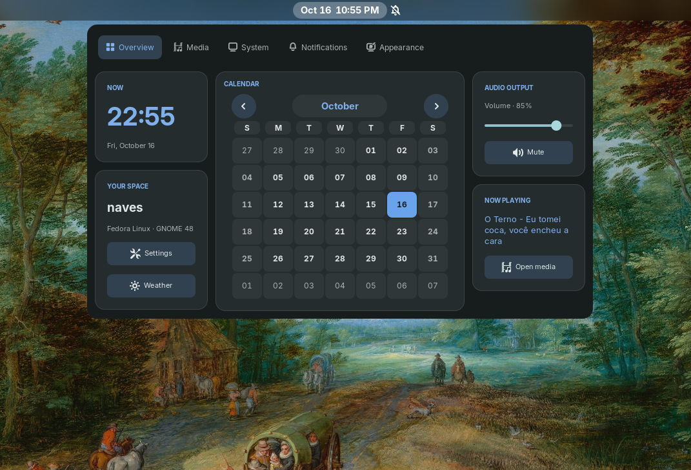
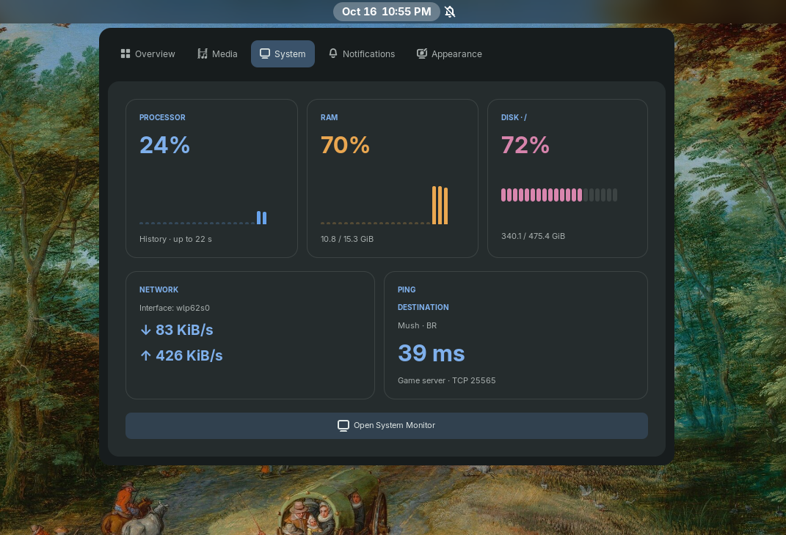
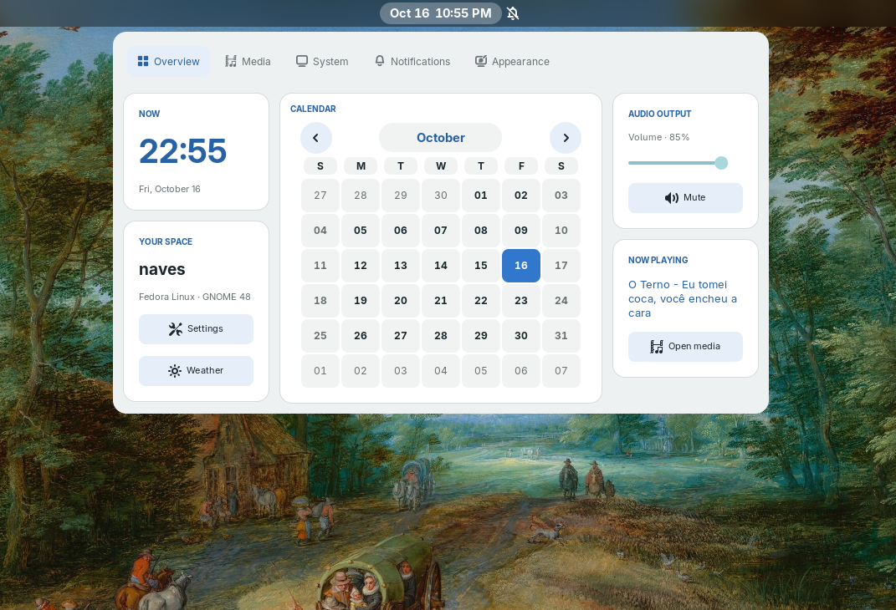
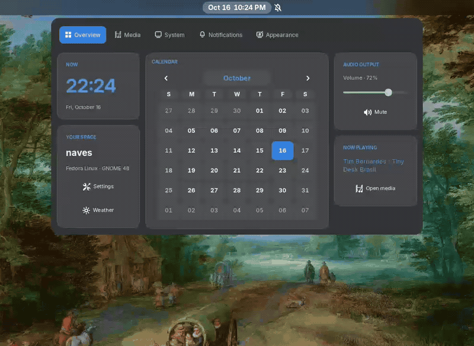

# Aevum — GNOME 48

Aevum is an open source GNOME Shell 48 extension that turns the date and time menu into a compact control panel. It brings together a calendar, audio and media controls, system and network activity, a game server connection check, notifications, and appearance settings. English is the source language. The interface follows the GNOME session language, with Brazilian Portuguese, Spanish, and French translations.

**Quick start:** On GNOME 48, run `bash setup.sh`, log out and back in, then run `gnome-extensions enable aevum@local`. See the installation steps below. Licensed under the [MIT License](LICENSE).

This is an experimental extension for **Fedora 42 / GNOME Shell 48.8 / Wayland**. The panel opens when you click the date and time in the top bar. It does not add another top bar button.

## Screenshots

### Overview — dark theme



### System — dark theme



### Overview — light theme



## Demo



## Installation

Extract the ZIP archive, open a terminal in the extracted directory (the one containing this README), and run:

```bash
bash setup.sh
```

Do not use `sudo`. The installer checks for GNOME 48, copies the extension and translations into your user extension directory, and backs up any previous installation of this extension. It does not install packages or change system files.

**Save your work, log out, and log back in.** On Wayland, do not use Alt+F2 → r to reload the Shell.

Then run:

```bash
gnome-extensions enable aevum@local
```

Click the date and time. If extensions are disabled globally, enable the main switch in the Extensions app.

## Features

- **Overview:** clock, date, native monthly calendar, user name, settings and weather shortcuts, volume and mute controls, and current track.
- **Media:** track title, artist, artwork, previous/play-pause/next controls, and MPRIS progress. With multiple players, the first one alphabetically is selected. When the player reports a duration, the centered progress bar shows the position and updates every second while the panel is open. Seeking is available when the player also exposes `CanSeek` and a valid track ID. After a seek, stale position readings are ignored for up to three seconds; the panel also listens for the player's `Seeked` signal. Duration-only updates preserve the displayed position. Artwork is shown when the player supplies an `mpris:artUrl` using `file://`, `http://`, or `https://`; otherwise, a music icon appears. Controls depend on the player's capabilities.
- **System:** recent CPU and RAM history charts, root disk (`/`) usage, the default network interface, and download/upload speeds. CPU, RAM, and network counters come from `/proc`; disk space comes from GIO. The ping card tests a TCP connection to the Mush game server in Brazil on port 25565. It runs every five seconds only while the System tab is open, including DNS resolution when needed. A failed connection shows “Destination not responding.” Local data updates every second while the panel is open; network rates need two samples.
- **Notifications:** shows GNOME's original notifications and calendar area below the panel tabs.
- **Appearance:** follows GNOME's light/dark mode and accent color by default. Automatic mode uses the Fedora panel gray and the system accent color. **Creator’s theme**, in the second position, retains the previous dark look. A fixed light theme, preset accent colors, and custom background, card, accent, and text colors in `#RRGGBB` format are also available. Changes appear immediately and are saved in `~/.config/aevum/appearance.json` (or under `$XDG_CONFIG_HOME`).
- **Languages:** follows the GNOME session language. English is the fallback; Brazilian Portuguese, Spanish, and French are translated. The date uses the session language's month names and ordering.
- **Layout:** fits within the primary monitor's width, rearranges tabs, cards, and fields below 700 logical pixels, and allows pages taller than the available space to scroll.
- **Disable:** removes the panel widgets and restores the original date and time menu visibility. Persistent GNOME settings are not changed.

The panel calendar displays days and lets you navigate months, but it does not load events. Use the Notifications tab for events and notifications.

The volume control uses the default audio output and is capped at 100%. This version does not switch devices or control the microphone.

The **Weather** shortcut opens GNOME Weather if it is installed. It does not display a made-up temperature or fetch weather automatically. **Open System Monitor** also requires its corresponding app. If an app is missing, a message appears in the panel.

The visual reference guided the colors, cards, and tabs; the extension does not reproduce every widget in the reference image exactly.

## Restore the default calendar

```bash
gnome-extensions disable aevum@local
```

To remove the extension after disabling it:

```bash
gnome-extensions uninstall aevum@local
```

If the interface fails, disable the extension and log back in. Avoid running it alongside other extensions that reorganize the date and time menu.

## Troubleshooting

```bash
gnome-extensions info aevum@local
journalctl --user -b --no-pager | grep -Ei 'aevum|JS ERROR' | tail -50
```

Share the relevant error message when reporting an issue; the entire session log is unnecessary.

## Verification and limitations

JavaScript and shell syntax, metadata, package structure, and installer paths have been checked. The calendar, date menu, and audio APIs were reviewed against the GNOME Shell 48 source code.

**Syntax has been checked, but rendering, audio, and MPRIS integration still need testing in a GNOME session.** This is an initial package, not an extension approved or published in the official catalog.

It targets GNOME 48 specifically; a GNOME upgrade may require changes. The panel's maximum width is about 784 logical pixels, including padding. The compact layout puts content into one column and caps page height so it can scroll.

## Customization

Open the **Appearance** tab to choose a theme and colors. Select **Automatic** to return to the default. You can also edit `stylesheet.css` in the installed directory; log out and back in after editing code or CSS.

## Translations

Translatable strings use gettext in `extension.js`. English source strings are used directly when no translation matches. Editable catalogs are in `po/pt_BR.po`, `po/es.po`, and `po/fr.po`; the installer copies their compiled catalogs from `locale/<language>/LC_MESSAGES/aevum.mo`. After editing a catalog, run `msgfmt --check -o locale/<language>/LC_MESSAGES/aevum.mo po/<language>.po` and reinstall the extension. Log out and back in to change the session language.

The extension ID is `aevum@local` and the gettext domain is `aevum`. The installer backs up a previous `naves-dashboard@local` installation, disables it, and copies its appearance settings to the Aevum configuration directory when no Aevum settings exist yet.

## Technical references

- https://gjs.guide/extensions/
- https://github.com/GNOME/gnome-shell/blob/gnome-48/js/ui/dateMenu.js
- https://github.com/GNOME/gnome-shell/blob/gnome-48/js/ui/calendar.js
- https://github.com/GNOME/gnome-shell/blob/gnome-48/js/ui/status/volume.js
- https://specifications.freedesktop.org/mpris/latest/

The GNOME source files referenced above are not included in this package. The extension uses the corresponding modules provided by the system.
